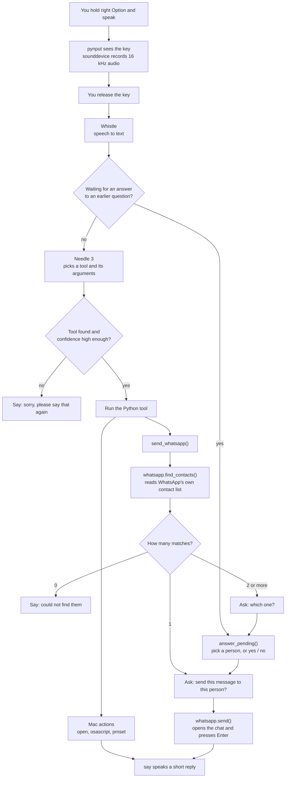

# Chotu Voice

A voice assistant that controls your Mac. Everything runs on the Mac itself.

Hold the right Option key and say "open bluetooth settings" or "send a WhatsApp to Yash saying hi how are you". The assistant hears you, works out what you want, and does it.

## What it can do

| Say | What happens |
|---|---|
| "open safari", "open notes", "open vs code" | Opens the app |
| "open settings", "open bluetooth settings" | Opens System Settings, on a page if you name one |
| "set volume to 30" | Sets the speaker volume |
| "mute", "unmute" | Mutes or unmutes the sound |
| "lock my screen" | Locks the screen |
| "turn on dark mode" | Switches dark or light mode |
| "send a whatsapp to yash saying hi how are you" | Finds Yash in WhatsApp, asks which one if there are several, confirms, then sends |

Anything else gets "Sorry, I can't do that yet".

## Models

Both models come from [Cactus Compute](https://cactuscompute.com/needle) and run on the CPU through the `cactus-needle` Python package. There are no API calls, and no audio or text leaves the Mac.

| Model | Job | Size | How we call it |
|---|---|---|---|
| **Whistle** | Speech to text | 16.9 MB | `needle.transcribe(audio, language="en", keywords=KEYWORDS)` |
| **Needle 3** | Picks a tool and fills in its arguments | 34 MB | `needle.Needle(tools=TOOLS, stateless=True).complete(text)` |

Official links, as listed on [cactuscompute.com/needle](https://cactuscompute.com/needle):

| What | Link |
|---|---|
| Needle home page | [cactuscompute.com/needle](https://cactuscompute.com/needle) |
| Whistle announcement | [cactuscompute.com/blog/whistle](https://cactuscompute.com/blog/whistle) |
| Hugging Face (model weights) | [huggingface.co/Cactus-Compute](https://huggingface.co/Cactus-Compute) |
| GitHub (source, `pip install cactus-needle`) | [github.com/cactus-compute/needle](https://github.com/cactus-compute/needle) |
| Python reference | [cactuscompute.com/blog/needle-python-docs](https://cactuscompute.com/blog/needle-python-docs) |
| Designing tools for Needle | [cactuscompute.com/blog/designing-tools-for-needle](https://cactuscompute.com/blog/designing-tools-for-needle) |
| Confidence scores | [cactuscompute.com/blog/needle-confidence](https://cactuscompute.com/blog/needle-confidence) |
| Fine-tuning Needle | [cactuscompute.com/blog/finetuning-needle](https://cactuscompute.com/blog/finetuning-needle) |

Notes on how we use them:

- **Whistle** takes 16 kHz mono audio, up to 30 seconds. `KEYWORDS` biases it towards words like "WhatsApp" and "Bluetooth".
- **Needle** reads each tool's Python signature and one-line docstring. A clear docstring means better routing.
- We call `complete()`, not `run()`. `complete()` only returns the choice, so our code decides whether to act.
- `stateless=True` keeps each command separate from the last one.
- Needle returns a `confidence` score. Below `MIN_CONFIDENCE` (0.3) we ask the user to repeat.
- `open_settings` and `send_whatsapp` skip that check. Opening Settings is harmless, and WhatsApp always asks before sending.
- `send_whatsapp` has regex `triggers`, because Needle alone misses short sentences like "whatsapp rahul I will be late".

The packages download the model files into `~/.cache/huggingface/hub/` the first time they run.

## Architecture



### The flow in steps

1. `listen()` records audio only while the right Option key is held.
2. On release, the audio goes to Whistle, which returns text.
3. `handle()` checks the `pending` state first. If the assistant asked a question, the text is treated as the answer.
4. If not, Needle picks a tool, like `open_settings(pane="bluetooth")`.
5. `handle()` checks the confidence, then calls the matching Python function.
6. The function does the Mac action and calls `speak()`. `speak()` runs `say` in the background, so it never blocks the next command.

### WhatsApp in steps

1. Needle returns `send_whatsapp(contact="yash", message="hi how are you")`.
2. `whatsapp.find_contacts("yash")` searches `ContactsV2.sqlite`, WhatsApp's own contact store, read-only.
3. With several matches, the assistant reads them out and sets `pending = {"step": "choose", ...}`.
4. You say "Shah" or "second one". `answer_pending()` picks the person.
5. It asks "Send hi how are you to Yash Shah?" and sets `pending = {"step": "confirm", ...}`.
6. On "yes", `whatsapp.send()` opens `whatsapp://send?phone=...&text=...` and presses Enter.

## Files

| File | What it holds |
|---|---|
| [main.py](main.py) | Hotkey and mic loop, the Needle tools, `handle()`, and the follow-up questions |
| [whatsapp.py](whatsapp.py) | Searches WhatsApp contacts and sends a message |
| [pyproject.toml](pyproject.toml) | Dependencies |

## Setup

Needs an Apple Silicon Mac, Python 3.13 and [uv](https://docs.astral.sh/uv/).

```bash
uv sync
uv run python main.py
```

Other ways to run it:

```bash
uv run python main.py --text open safari   # one typed command, no mic
uv run python main.py --chat               # type commands, including follow-up answers
```

### macOS permissions

Give these to the app you run it from, like Terminal or VS Code:

| Permission | Why |
|---|---|
| Microphone | To record your voice |
| Input Monitoring | So `pynput` can see the right Option key |
| Accessibility | To press Enter in WhatsApp |
| Automation → System Events | For dark mode and pressing Enter |
| Access data from other apps | To read WhatsApp's contact list |

WhatsApp desktop must be installed and logged in.

## Adding a command

1. Write a function in `main.py` with the `@needle.tool` decorator.
2. Give it typed arguments and a clear one-line docstring. Needle reads both.
3. Add it to `TOOLS`.
4. Test the routing with `uv run python main.py --text <your sentence>`.

## Known limits

- Whistle understands English, German, French, Spanish, Italian, Dutch and Polish. It has no Hindi.
- Needle can lose words in short, casual sentences. The WhatsApp confirm step is there to catch this.
- Needle cannot see the screen. It can only do what a tool in `TOOLS` does.
- WhatsApp calls are not supported, because WhatsApp has no link for starting one.

## Next steps

- A floating window and menubar icon, then packaging as a `.app`.
- Always listening, with a wake word and `webrtcvad` to detect the end of speech.
- Fine-tuning Needle on our own command sentences for better confidence.
